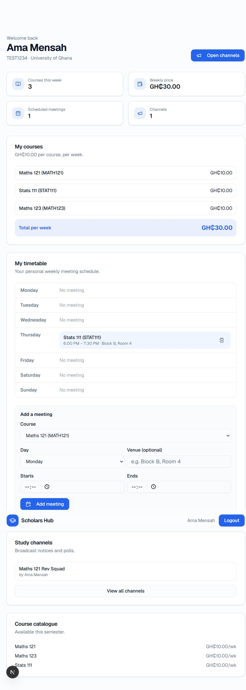
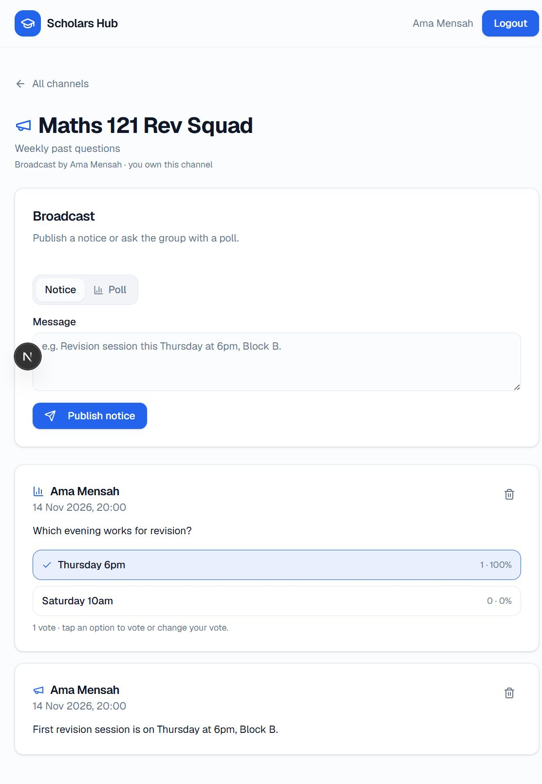
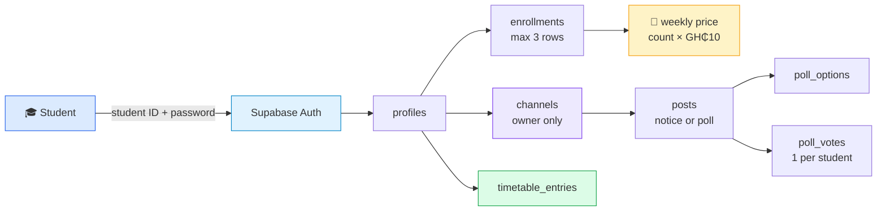

<div align="center">


<a href="https://github.com/BrytTito/SCHOLARS-HUB">
  
</a>

<br/>

<a href="https://github.com/BrytTito/SCHOLARS-HUB/actions/workflows/ci.yml"></a>
<a href="https://github.com/BrytTito/SCHOLARS-HUB/releases"></a>


<br/><br/>


</div>

<br/>

<div align="center">

### 🎓 Register → 💸 See your weekly price → 📣 Join the channels → 🗓️ Plan your week

</div>

---

## ✨ What it does

<table>
<tr>
<td width="50%" valign="top">

### 📝 Registration
Students sign up with their **student ID, full name and school**, then choose **1–3 courses** from:

| Course | Code | Weekly price |
| :--- | :---: | ---: |
| Maths 121 | `MATH121` | **GH₵10.00** |
| Maths 123 | `MATH123` | **GH₵10.00** |
| Stats 111 | `STAT111` | **GH₵10.00** |

The **weekly total updates live** as courses are ticked — 2 courses = `GH₵20.00`, 3 = `GH₵30.00`.

</td>
<td width="50%" valign="top">

### 📣 Channels & polls
Every student can create a **broadcast channel**.
Only the owner publishes — exactly like a Telegram channel.

- 📢 Notices with author + timestamp
- 📊 Polls with 2–6 options
- ✅ One vote per student, changeable anytime
- 📈 Live counts and percentages

</td>
</tr>
<tr>
<td width="50%" valign="top">

### 🗓️ Personal timetable
Each student builds a **Mon–Sun calendar** of meeting days:

- Course, day, start and end time
- Optional venue
- Delete any entry in one click
- Enforced `end > start` at the database level

</td>
<td width="50%" valign="top">

### 🔐 Real accounts, real security
- Student ID doubles as the login name
- Postgres **row-level security on all 8 tables**
- A 4th course is rejected by the database, not just the UI
- Students can never read another student's timetable

</td>
</tr>
</table>

---

## 📸 Screens

<div align="center">

<table>
<tr>
<td align="center" width="50%">

<br/><sub><b>Dashboard</b> — courses, weekly total, timetable, channels</sub>
</td>
<td align="center" width="50%">

<br/><sub><b>Channel</b> — broadcast form, notice and live poll results</sub>
</td>
</tr>
</table>

</div>

---

## 🧠 How it fits together



<details>
<summary><b>Database schema (click to expand)</b></summary>

```sql
courses            (code PK, title, short_title, weekly_price)
profiles           (id PK → auth.users, student_id UNIQUE, full_name, school)
enrollments        (profile_id, course_code)            -- PK(profile_id, course_code)
channels           (id, name, description, owner_id → profiles)
posts              (id, channel_id, author_id, kind ∈ {notice, poll}, body)
poll_options       (id, post_id, label, position)
poll_votes         (post_id, voter_id, option_id)        -- PK(post_id, voter_id)
timetable_entries  (id, profile_id, course_code, day_of_week, start_time, end_time, location)
```

Security highlights:

- `enrollments` INSERT policy refuses a 4th row: `(select count(*) … ) < 3`
- Only a channel owner may `INSERT` into `posts` for that channel
- Only a poll's author may add its `poll_options`
- Votes upsert on `(post_id, voter_id)`, so changing your mind works
- RLS enabled on every table, with `auth.uid()` checks throughout

</details>

---

## 🚀 Quick start

<table>
<tr><td><b>1 · Supabase</b></td></tr>
<tr><td>

Create a free project at [supabase.com/dashboard](https://supabase.com/dashboard), open **SQL Editor → New query**, paste all of [`supabase/schema.sql`](supabase/schema.sql) and run it.

</td></tr>
<tr><td><b>2 · Turn off email confirmation</b></td></tr>
<tr><td>

**Authentication → Sign In / Providers → Email → Confirm email = OFF**, then save.

> Student IDs have no inbox, so the app derives an internal address such as
> `10987654@students.scholarshub.app`. Never leave confirmation on — signups
> would create the user but never a session.

</td></tr>
<tr><td><b>3 · Environment</b></td></tr>
<tr><td>

```bash
cp .env.example .env.local
```

```dotenv
NEXT_PUBLIC_SUPABASE_URL=https://xxxxxxxxxxxx.supabase.co
NEXT_PUBLIC_SUPABASE_PUBLISHABLE_KEY=sb_publishable_...
```

</td></tr>
<tr><td><b>4 · Run</b></td></tr>
<tr><td>

```bash
npm install
npm run dev      # http://localhost:3000
```

</td></tr>
</table>

| Script | Does |
| :--- | :--- |
| `npm run dev` | Development server |
| `npm run build` | Production build |
| `npm run start` | Serve the build |
| `npm run typegen` | Generate Next.js route types |
| `npm run typecheck` | `tsc --noEmit` |
| `npm run lint` | ESLint |

---

## 🌳 Branches & releases

| Branch | Purpose |
| :--- | :--- |
| `main` | Production-ready code, tagged on every release |
| `develop` | Integration branch for the next release |
| `feature/*` | Short-lived work branches, merged into `develop` |
| `fix/*` | Bug fixes |

```bash
git checkout develop
git checkout -b feature/my-change
# ...work, commit...
git checkout develop && git merge --no-ff feature/my-change
git checkout main && git merge --ff-only develop
git tag -a v1.1.0 -m "v1.1.0" && git push origin main --tags
```

### Releases

| Tag | Date | Highlights |
| :--- | :--- | :--- |
| [`v1.0.0`](https://github.com/BrytTito/SCHOLARS-HUB/releases/tag/v1.0.0) | 14 Nov 2026 | First release — registration + pricing, channels with polls, personal timetable, RLS, CI |

---

## ☁️ Deploy

[](https://vercel.com/new/clone?repository-url=https%3A%2F%2Fgithub.com%2FBrytTito%2FSCHOLARS-HUB&env=NEXT_PUBLIC_SUPABASE_URL,NEXT_PUBLIC_SUPABASE_PUBLISHABLE_KEY)

1. Import the repo into Vercel.
2. Add `NEXT_PUBLIC_SUPABASE_URL` and `NEXT_PUBLIC_SUPABASE_PUBLISHABLE_KEY`.
3. In Supabase → **Authentication → URL Configuration**, add your Vercel domain.

---

## 🗺️ Roadmap

### Shipped in v1.0.0

- [x] Student ID registration with live weekly pricing
- [x] Broadcast channels, notices and polls with live results
- [x] Personal Mon–Sun timetable
- [x] Row-level security + CI

### Next

- [ ] Change / re-select courses after registration, and edit your profile
- [ ] Privacy notice, terms and a privacy-aware data model — the app stores student IDs and emails
- [ ] WhatsApp-style member chat inside channels (membership, replies, unread, realtime)
- [ ] Admin dashboard listing all registrations and weekly revenue
- [ ] Mobile payments (MoMo) for weekly renewals and expiring-subscription reminders
- [ ] Tests and a test job in CI — there are currently none, so nothing guards a payment change

### Full plan

**[`docs/ROADMAP.md`](docs/ROADMAP.md)** holds the detailed, code-grounded plan: 16 gaps found in
the current code, eight phases with acceptance criteria, the schema additions each phase needs,
six decisions to make before starting, and a suggested first week. Read it before opening a PR
on any of the items above.

---

<div align="center">


<sub>Built with Next.js · React · TypeScript · Tailwind CSS · Supabase · shadcn/ui</sub>

<br/>

<a href="https://github.com/BrytTito/SCHOLARS-HUB/issues">🐛 Report a bug</a> ·
<a href="https://github.com/BrytTito/SCHOLARS-HUB/issues">💡 Request a feature</a> ·
<a href="https://github.com/BrytTito/SCHOLARS-HUB">⭐ Star the repo</a>

</div>
